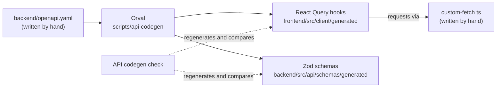

# The API contract

For whoever adds or changes an API endpoint: where the contract between the
frontend and the backend is written down, what is generated from it, and the
steps for changing it.

## Spec-first

The backend is an [Express](https://expressjs.com/) app: a Node.js library
that maps an HTTP method and path to a handler function, and does little
else. The frontend calls it over HTTP. What each endpoint accepts and returns
is written down once, by hand, in `backend/openapi.yaml`, the **spec**: an
[OpenAPI](https://www.openapis.org/) document listing each path, its
parameters, its request body and its responses.

Writing the spec by hand and generating code from it is called **spec-first**.
The other way round, **code-first**, generates the spec from the handlers'
code. FastAPI, for example, builds one from the type hints on each handler.
Express has no such generator built in, and adding one means describing every
handler a second time in that library's terms, so this project is spec-first.

## One command feeds both sides

[Orval](https://orval.dev/) reads the spec and generates two things:

- **Zod schemas**, in `backend/src/api/schemas/generated`. [Zod](https://zod.dev/)
  is a library for checking at runtime that a value has the expected shape.
  Handlers parse their requests with these schemas and reject one the spec
  doesn't allow, and parse their responses with them before sending them.
  The enquiry handler in `backend/src/api/routes/enquiries.ts`, for example,
  uses `CreateEnquiryBody` and `CreateEnquiryResponse`.
- **React Query hooks**, in `frontend/src/client/generated`.
  [React Query](https://tanstack.com/query) is a library that fetches data
  for React components and caches it. Each endpoint gets a hook, such as
  `useListResources` or `useCreateEnquiry`, with its parameters and response
  typed from the spec. Every hook sends its request through the **mutator**,
  `frontend/src/client/custom-fetch.ts`: Orval's name for the hand-written
  function that does the actual `fetch`, which is where the base URL and error
  handling live.



Because one command writes both sides from one file, the frontend's idea of
an endpoint and the backend's can't drift apart unnoticed: change the spec,
regenerate, and typecheck fails wherever code still expects the old shape.
The generated code is committed and never edited by hand, and nothing reads
the spec at runtime, so builds and deploys don't run Orval.

The Workspace forms are the exception. `resource-editor.tsx` and `profile.tsx`
in `frontend/src/pages/workspace`, and `TutorFormDialog.tsx`, validate with
Zod schemas written by hand, so their rules can drift from the spec. That
check only gives quicker feedback; the server's check against the generated
schemas is the one that counts.

## Why the generator lives in `scripts`

Orval writes into both apps, so it belongs to neither. Its config,
`scripts/api-codegen/orval.config.ts`, sits in the tooling package next to
[the API codegen check](code-checks.md#the-api-codegen-check). The generated
code stays inside each app, because each app imports, builds and deploys it,
and `scripts` never ships. The spec stays in `backend`, because it is edited
alongside the handlers.

Where the config says `workspace`, that is Orval's word for an output folder,
not the [Workspace](../GLOSSARY.md#the-private-area).

## Change an endpoint

Run the commands inside the container: prefix them with
`docker compose exec api` ([local-docker.md](local-docker.md)).

1. Edit `backend/openapi.yaml`.
2. Regenerate both sides. This also runs `pnpm run typecheck`:

   ```sh
   pnpm --filter @welltutored/scripts run api-codegen
   ```

3. Fix what typecheck reports, then update the handler in
   `backend/src/api/routes` and the components that call the hook.
4. Commit the spec, the generated code and the hand-written changes together.

If you skip step 2, [the API codegen check](code-checks.md#the-api-codegen-check)
fails `verify` and names the command to run.
