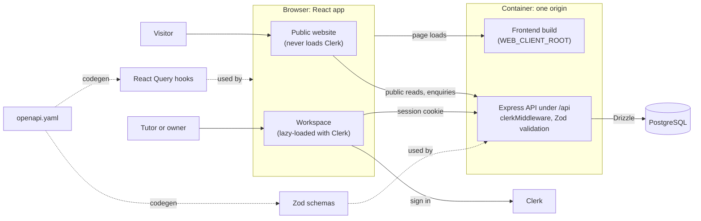

# Well Tutored architecture

One container serves both the React frontend and the Express API from the same
origin (scheme, host and port), so the browser treats them as one site. Only
the API talks to the PostgreSQL database, through Drizzle, and a client
generated from the OpenAPI spec keeps the two sides in step. The application
is organized around two user-facing surfaces: the public website and the
private Workspace.

Solid arrows are runtime requests. Dotted arrows are code generated from
`lib/api-spec/openapi.yaml`, which keeps the client and server agreeing on one
contract. Serving everything from one origin is
[ADR-0001](adr/0001-single-origin-deployment.md).

Every route below is defined in `artifacts/welltutored/src/app/route-map.ts`,
which is the source of truth if this list and the code disagree.

## Public website

The React app serves the public experience:

- `/` — tutor discovery homepage
- `/tutors/:slug` — published tutor profile
- `/resources` — published resource library
- `/resources/:slug` — published resource detail
- `/enquire` — enquiry form

The two resource routes, and every link to them, exist only while
`PUBLIC_RESOURCES_ENABLED` in `src/lib/features.ts` is on. It is off for now,
so visitors see no resources; tutors still write and publish them in the
Workspace.

Public pages use the shared `Shell` for navigation, footer, policy dialogs, and
the public visual language. Public API handlers live in
`artifacts/api-server/src/routes/content.ts` and
`artifacts/api-server/src/routes/enquiries.ts`. `content.ts` also holds the
saved-resources endpoints, which no page uses yet (#69).

## Authentication

Clerk provides the sign-in and sign-up pages:

- `/sign-in` — sign-in flow (including Clerk's nested flow paths)
- `/sign-up` — sign-up flow (including Clerk's nested flow paths)

Public visitors never load Clerk. `App.tsx` lazy-loads `PublicApp` or
`AuthenticatedApp` by path, and only the authenticated side brings in Clerk,
its themes, and the workspace routes. Keep public route modules, shared
providers, and route metadata free of Clerk imports, or Clerk lands in the
public bundle.

Browser API requests use Clerk's same-origin session cookies; bearer-token
wiring is reserved for mobile clients.

## Workspace

Workspace routes are protected by Clerk and the workspace account boundary:

- `/workspace` — dashboard
- `/workspace/enquiries` — workspace enquiry list and retry actions
- `/workspace/profile` — tutor profile drafts and publishing
- `/workspace/resources/new` — create a resource
- `/workspace/resources/:id` — edit a resource
- `/workspace/tutors` — owner-only tutor profile management
- `/workspace/accounts` — owner-only account approval and tutor assignment

`/workspace/articles/new` and `/workspace/articles/:id` remain compatibility
aliases and redirect to the canonical resource URLs. Workspace accounts are
stored in the `workspace_accounts` table.

## Forms

A form that must submit once guards itself with a synchronous ref as well as
the mutation's pending state, as `submissionInFlight` does in `EnquiryForm`.
Keyboard activation can fire a second submit before React renders the first
one as pending, so the pending flag alone lets a duplicate through.

## API boundaries

Workspace code is split by responsibility:

- `auth/workspace-access.ts` — authenticated account lookup and role checks
- `services/workspace-account-service.ts` — Clerk-to-workspace account
  provisioning, tutor assignment initialization, slug allocation, and accent
  availability
- `domain/workspace-validation.ts` — publishability rules for resources and
  tutor profiles
- `presenters/resource-presenter.ts` — resource response mapping and joined
  resource lookup
- `presenters/tutor-presenter.ts` — tutor response mapping and draft overlay
- `routes/workspace.ts` — composition point that mounts the workspace subrouters;
  it does not contain all workspace validation or database mutations
- `routes/workspace-session.ts` — workspace session and current-account
  endpoints
- `routes/workspace-resources.ts` — resource request validation and resource
  mutations
- `routes/workspace-profile.ts` — tutor profile request validation and profile
  mutations
- `routes/workspace-tutors.ts` — owner-only tutor management
- `routes/workspace-accounts.ts` — owner-only workspace account management
- `routes/enquiries.ts` — public enquiry creation and workspace enquiry list and
  retry handlers

The intended direction for future workspace changes is to keep route handlers
thin: authenticate, validate the request, call a domain/service function, and
present the response. `lib/api-spec/openapi.yaml` generates both the React
Query hooks and the Zod schemas, which keeps client and server contracts
aligned. Generated API clients and schemas remain generated artifacts and
should not be edited manually.

## Publishing rules

- A published tutor profile can have a private draft.
- Public routes read published tutor and resource state.
- Publishing validates the complete object before changing its status.
- Discarding a tutor profile draft restores the published profile.
- Archived tutors must be restored before editing.
- A tutor account can edit its own resources; an owner can manage all workspace
  records.

### Tutor profiles versus resources

Tutor profiles keep the published profile in `tutors` and store workspace edits
in `tutor_profile_drafts`. This means the public site continues to show the
last published profile while a new version is being edited, and the draft can
be published or discarded as a whole.

Resources use a single `resources` row with a `draft` or `published` status.
New or explicitly draft resources do not appear publicly until published.
Editing an already-published resource while keeping its status as `published`
updates the public resource in place; changing it to `draft` removes it from
public results while it is being revised. Resources do not currently keep a
private draft alongside a live published version.

## Styling payload

The Well Tutored Vite build enables Tailwind's production Lightning CSS
optimization. `artifacts/welltutored/scripts/verify-css-build.mjs` holds a size
budget for the primary stylesheet; run
`pnpm --filter @workspace/welltutored run build` followed by
`pnpm --filter @workspace/welltutored run verify:css` to check it, and the
script prints the current size.

The remaining global CSS is intentional: Tailwind preflight, theme variables,
utilities used by both public and authenticated routes, motion states, and
registered custom properties are shared so route transitions do not flash
unstyled content. The authenticated route's separate CSS chunk is currently
negligible; further savings would require splitting shared styles and
reintroducing them during navigation.