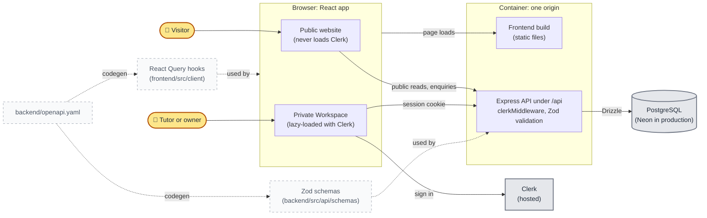
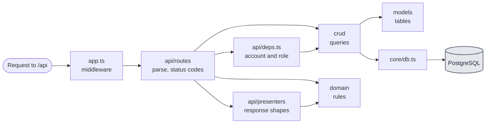

# Well Tutored architecture

For whoever needs to know how the code fits together: routes, authentication,
API boundaries and publishing rules. Why the less obvious decisions were made is
in [adr/](adr/).

One container serves both the React frontend and the Express API from the same
origin (scheme, host and port), so the browser treats them as one site. Only
the API talks to the PostgreSQL database, through Drizzle, and a client
generated from the OpenAPI spec keeps the two sides in step. The application
is organised around two user-facing surfaces: the public website and the
private [Workspace](../GLOSSARY.md#the-private-area).

Amber shapes are people, grey boxes are hosted services outside the container,
and dashed boxes are build-time code rather than running parts. Solid arrows
are runtime requests. Dotted arrows are code generated from
`backend/openapi.yaml`, which keeps the client and server agreeing on one
contract. Serving everything from one origin is
[ADR-0001](adr/0001-single-origin-deployment.md).

Every route is defined in `frontend/src/app/route-map.ts`.

## Public website

The React app serves the public experience: the
[Directory](../GLOSSARY.md#the-public-site) on `/`, published tutor profiles,
the resource library and the enquiry form.

The resource routes (`/resources` and `/resources/:slug`), and every link to
them, exist only while
`PUBLIC_RESOURCES_ENABLED` in `frontend/src/lib/features.ts` is on. While it is
off, visitors see no resources; tutors still write and publish them in the
Workspace.

Public pages use the shared `Shell` for navigation, footer, policy dialogs, and
the public visual language. Public API handlers live in
`backend/src/api/routes/content.ts` and
`backend/src/api/routes/enquiries.ts`.

## Authentication

Clerk provides the sign-in and sign-up pages:

- `/sign-in` — sign-in flow (including Clerk's nested flow paths)
- `/sign-up` — sign-up flow (including Clerk's nested flow paths)

Public visitors never load Clerk. `App.tsx` lazy-loads `PublicApp` or
`AuthenticatedApp` by path, and only the authenticated side brings in Clerk,
its themes, and the Workspace routes. Keep public route modules, shared
providers, and route metadata free of Clerk imports, or Clerk lands in the
public bundle.

Browser API requests use Clerk's same-origin session cookies; bearer-token
wiring is reserved for mobile clients.

## Private Workspace

Workspace routes, all under `/workspace`, are protected by Clerk and the
Workspace Account check. A Tutor edits their own profile and resources and
sees their enquiries; the [Owner](../GLOSSARY.md#the-private-area) also manages
every tutor profile and approves accounts.

`/workspace/articles/new` and `/workspace/articles/:id` remain compatibility
aliases and redirect to the canonical resource URLs. Workspace Accounts are
stored in the `workspace_accounts` table.

## Forms

A form that must submit once guards itself with a synchronous ref as well as
the mutation's pending state, as `submissionInFlight` does in `EnquiryForm`.
Keyboard activation can fire a second submit before React renders the first
one as pending, so the pending flag alone lets a duplicate through.

## Backend layout

The backend follows the shape of the
[full-stack FastAPI template](https://github.com/fastapi/full-stack-fastapi-template),
in TypeScript. Each folder in `backend/src` has one job, and a request passes
through them in one direction:

Each part of `backend/src` has one job:

- `main.ts` starts the process: seeds illustrative content in development,
  then listens. `app.ts` builds the Express app: the Public Origin redirect,
  CORS, Clerk on `/api`, the trusted-origin check on `/api/workspace`, the
  routes, then the frontend build and the error handler.
- `api/routes` — one router per area, which `api/routes/index.ts` mounts and
  `api/routes/workspace.ts` splits further. Handlers stay thin: authenticate,
  validate the request against `api/schemas`, call `crud` and `domain`, and
  present the response.
- `api/deps.ts` — the signed-in Workspace Account and role checks.
- `api/middleware` — request origin, Public Origin redirect and the API error
  handler.
- `api/presenters` — database rows to response bodies.
- `crud` — every database query, one module per area (tutors, resources,
  enquiries, workspace accounts), including Workspace Account provisioning
  from Clerk and tutor assignment.
- `domain` — rules with no database or HTTP in them, such as
  publishability of resources and tutor profiles, names, slugs and accents.
- `models` — the Drizzle schema, one file per table.
- `core` — settings (`config.ts` names every environment variable the API reads),
  the database pool, logging, the health check and serving the frontend build.
- `seed.ts` — the illustrative content for development.

Backend tests live in `backend/tests`, mirroring `src`. Frontend tests sit
next to the components they test.

`backend/openapi.yaml` generates both the React Query hooks in
`frontend/src/client` and the Zod schemas in `backend/src/api/schemas`, which
keeps client and server contracts aligned. Generated code isn't edited by
hand.

## Publishing rules

These rules apply to everything the Workspace publishes:

- A published tutor profile can have a private draft.
- Public routes read published tutor and resource state.
- Publishing validates the complete object before changing its status.
- Discarding a tutor profile draft restores the published profile.
- Archived tutors must be restored before editing.
- A tutor account can edit its own resources; an Owner can manage all Workspace
  records.

### Tutor profiles versus resources

[Tutor](../GLOSSARY.md#the-public-site) profiles keep the published profile in
`tutors` and store Workspace edits in `tutor_profile_drafts`. This means the
public site continues to show the last published profile while a new version is
being edited, and the draft can be published or discarded as a whole.

[Resources](../GLOSSARY.md#the-public-site) use a single `resources` row with a
`draft` or `published` status. New or explicitly draft resources don't appear
publicly until published. Editing an already-published resource while keeping
its status as `published` updates the public resource in place; changing it to
`draft` removes it from public results while it is being revised. Resources do
not keep a private draft alongside a live published version.

## Bundle size

The Well Tutored Vite build enables Tailwind's production Lightning CSS
optimisation. `frontend/scripts/verify-css-build.mjs` holds a size
budget for the primary stylesheet, set about 7% above its size in October 2026
so that growth is a decision rather than drift. `pnpm run verify` checks it
after the build. Run the commands in this section inside the container
([local-docker.md](local-docker.md)). To check the budget alone, run
`pnpm --filter @welltutored/frontend run build` followed by
`pnpm --filter @welltutored/frontend run check:css-size`; the script prints the
current size.

For the JavaScript, run
`pnpm --filter @welltutored/frontend run report:bundle-size`. It builds the
frontend, then reads the chunk report that a plugin in
`frontend/vite.config.ts` writes on every build, and prints each chunk's raw
and gzip size, marked as entry or lazy, followed by the twenty largest modules
in the entry chunk and in any chunk that imports more than one other. Unlike
`check:css-size` it has no budget, and nothing runs it in CI: it is for looking
into a size change by hand.

The remaining global CSS is intentional: Tailwind preflight, theme variables,
utilities used by both public and authenticated routes, motion states, and
registered custom properties are shared so route transitions don't flash
unstyled content. The authenticated route's separate CSS chunk is small, and
further savings would require splitting shared styles and
reintroducing them during navigation.