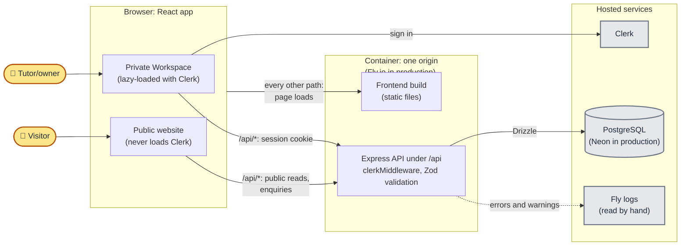

# Well Tutored architecture

For whoever needs to know how the code fits together: routes, authentication,
API boundaries and publishing rules. Why the less obvious decisions were made is
in [adr/](adr/).

## Overview

The application has two user-facing surfaces: the public website and the
private [Workspace](../GLOSSARY.md#the-private-area). Routes are defined in
`frontend/src/app/route-map.ts`.

One container serves both the React frontend and the Express API from the same
origin, so the browser treats them as one site
([ADR-0001](adr/0001-single-origin-deployment.md)). In production it runs on
Fly.io ([pipeline.md](pipeline.md)). Only the API talks to the PostgreSQL
database, through Drizzle. Both the frontend and the backend use
[code generated from the OpenAPI spec](api-contract.md), which keeps the two
sides in step.

Nothing alerts on errors. The API writes its errors to its log, which Fly
collects and `flyctl logs` shows. Errors in the browser go nowhere: a failed
request shows a message on the page, and only a crash caught by the error
boundary is also logged to the browser console.

### Runtime: where a request goes

In this diagram, each solid arrow is a request, pointing from whoever sends
it; the reply comes back along the same arrow.

Two things answer before either box. A request on any host other than the
[Public Origin](../GLOSSARY.md#delivery) gets a 301 to it, and an unknown
`/api` path gets a JSON 404 rather than the frontend's page.

## Public website

The React app serves the public experience: the
[Directory](../GLOSSARY.md#the-public-site) on `/`, published tutor profiles,
the resource library and the enquiry form.

The resource routes (`/resources` and `/resources/:slug`), and every link to
them, exist only while
`PUBLIC_RESOURCES_ENABLED` in `frontend/src/lib/features.ts` is on. While it is
off, visitors see no resources; tutors still write and publish them in the
Workspace.

Public pages use the shared `Shell` for navigation, footer, policy dialogs, and
the public visual language. Public API handlers live in
`backend/src/api/routes/content.ts` and
`backend/src/api/routes/enquiries.ts`.

## Authentication

Clerk provides the sign-in and sign-up pages:

- `/sign-in` — sign-in flow (including Clerk's nested flow paths)
- `/sign-up` — sign-up flow (including Clerk's nested flow paths)

Public visitors never load Clerk. `App.tsx` lazy-loads `PublicApp` or
`AuthenticatedApp` by path, and only the authenticated side brings in Clerk,
its themes, and the Workspace routes. Keep public route modules, shared
providers, and route metadata free of Clerk imports, or Clerk lands in the
public bundle.

Browser API requests use Clerk's same-origin session cookies; bearer-token
wiring is reserved for mobile clients.

The server reads the session on every `/api` request, public or private:
`clerkMiddleware` in `backend/src/app.ts` reads it, and each handler decides
whether it needs one. A Workspace request is turned away at the first of these
checks it fails:

- `requireTrustedMutationOrigin`, in `app.ts` on `/api/workspace`, returns a
  403 before any handler runs for a change (anything but `GET`, `HEAD` or
  `OPTIONS`) sent from another site.
- `requireWorkspaceAccount` in `backend/src/api/deps.ts`, which every
  Workspace handler calls, returns a 401 with no session and a 403 for an
  account without a verified email address.
- The handler then calls one role check: `requireApproved` returns a 403 for
  an account still awaiting approval, and `requireOwner` a 403 for anyone but
  the Owner. `/api/workspace/me` calls neither, so an account awaiting
  approval can still load the Workspace and see that it is waiting.

## Private Workspace

Workspace routes, all under `/workspace`, are protected by the checks in
[Authentication](#authentication). A Tutor edits their own profile and resources and
sees their enquiries; the [Owner](../GLOSSARY.md#the-private-area) also manages
every tutor profile and approves accounts.

`/workspace/articles/new` and `/workspace/articles/:id` remain compatibility
aliases and redirect to the canonical resource URLs. Workspace Accounts are
stored in the `workspace_accounts` table.

## Backend layout

The backend follows the shape of the
[full-stack FastAPI template](https://github.com/fastapi/full-stack-fastapi-template),
in TypeScript. A request passes through the folders in `backend/src` in one
direction.

### Inside the API: one request through `backend/src`

A typical Workspace request goes from `app.ts` to its handler in
`api/routes`, which checks the account with `api/deps.ts` and then queries
through `crud` and `core/db.ts`.

Each part of `backend/src` has one job:

- `main.ts` — starts the process: seeds illustrative content in development,
  then listens.
- `app.ts` — builds the Express app: the Public Origin redirect, CORS, Clerk
  on `/api`, the trusted-origin check on `/api/workspace`, the routes, then the
  frontend build and the error handler.
- `api/routes` — one router per area, which `api/routes/index.ts` mounts and
  `api/routes/workspace.ts` splits further. Handlers stay thin: authenticate,
  validate the request against `api/schemas`, call `crud` and `domain`, and
  present the response.
- `api/deps.ts` — the signed-in Workspace Account and role checks.
- `api/middleware` — request origin, Public Origin redirect and the API error
  handler.
- `api/presenters` — database rows to response bodies.
- `api/public-cache.ts` — the `Cache-Control` header for public tutor
  responses.
- `crud` — every database query, one module per area (tutors, resources,
  enquiries, workspace accounts), including Workspace Account provisioning
  from Clerk and tutor assignment.
- `domain` — rules with no database or HTTP in them, such as
  publishability of resources and tutor profiles, names, slugs and accents.
- `models` — the Drizzle schema, one file per table.
- `core` — settings (`config.ts` names every environment variable the API reads),
  the database pool, logging, the health check and serving the frontend build.
- `seed.ts` — the illustrative content for development.

Backend tests live in `backend/tests`, mirroring `src`. Frontend tests sit
next to the components they test.

The Zod schemas in `api/schemas` are generated from `backend/openapi.yaml`,
as [api-contract.md](api-contract.md) explains.

## Publishing rules

These rules apply to everything the Workspace publishes:

- A published tutor profile can have a private draft.
- Public routes read published tutor and resource state.
- Publishing validates the complete object before changing its status.
- Discarding a tutor profile draft restores the published profile.
- Archived tutors must be restored before editing.
- A tutor account can edit its own resources; an Owner can manage all Workspace
  records.

### Tutor profiles versus resources

[Tutor](../GLOSSARY.md#the-public-site) profiles keep the published profile in
`tutors` and store Workspace edits in `tutor_profile_drafts`. This means the
public site continues to show the last published profile while a new version is
being edited, and the draft can be published or discarded as a whole.

[Resources](../GLOSSARY.md#the-public-site) use a single `resources` row with a
`draft` or `published` status. New or explicitly draft resources don't appear
publicly until published. Editing an already-published resource while keeping
its status as `published` updates the public resource in place; changing it to
`draft` removes it from public results while it is being revised. Resources do
not keep a private draft alongside a live published version.
