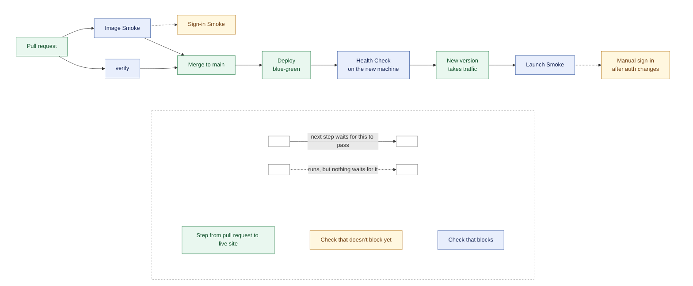

# Pipeline

For whoever wants to know what happens between a pull request and the live
site, or why a check went red: every check, where it runs and what blocks, and
how a deploy switches over, fails or is rolled back.
Each check, from pull request to live site:



| Check | Runs against | When | Covers | By hand |
|---|---|---|---|---|
| `verify` (`verify:ci`) | The repository, with a temporary PostgreSQL | Every PR and `main` | Tests (including `test:smoke`), typecheck, build, docs, CSS budget | `docker compose run --rm test` |
| [Image Smoke](#the-image-smoke) (`smoke:dev`, `smoke:enquiry`) | The production image, with a seeded throwaway database | Every PR and `main` | Image starts; health, catalogue, public pages, invalid-enquiry recovery; the enquiry form in a real browser (`smoke:enquiry`, not blocking yet) | [By hand](smoke-checks.md#the-image-smoke-by-hand) |
| [Sign-in Smoke](smoke-checks.md#the-sign-in-smoke) (`smoke:sign-in`) | The same container, through the Clerk development instance | Every PR and `main`, not blocking yet | Sign-in, [Workspace](../GLOSSARY.md#the-private-area) opens, profile edit saves, [Resource](../GLOSSARY.md#the-public-site) publishes but stays hidden | `smoke:sign-in` against a container built with a `pk_test_` key ([smoke-checks.md](smoke-checks.md#the-sign-in-smoke)) |
| [Health Check](#blue-green-deploys) (`/api/healthz`) | The new Fly machine | During a [Deploy](#the-deploy-job), before it takes traffic | Process up, database answers `SELECT 1` within 3s | — (`curl` shows the answer, but gates nothing) |
| [Launch Smoke](#post-deploy-validation) (`smoke:launch`) | `https://welltutored.co.uk` | After a [Deploy](#the-deploy-job) | Published [Tutor](../GLOSSARY.md#the-public-site), pages, enquiry recovery, redirects, certificates, Clerk production instance | [smoke-checks.md](smoke-checks.md#the-launch-smoke) |
| Manual sign-in | `https://welltutored.co.uk` | After merging an auth, Clerk or `@clerk/*` change | The production Clerk instance's settings and cookies | It is by hand |

## Deterministic CI validation

`pnpm run verify:ci` is the deterministic quality gate: the test suites,
`pnpm run build` (which runs the [Docs Check](code-checks.md#the-docs-check)
and the typecheck) and the CSS budget, stopping at the first failure. It does
not depend on a running dev stack or a deployed URL. The steps and their order
are `verify:ci:checks` in the root `package.json`, and
[code-checks.md](code-checks.md) explains each.

It runs the integration tests against a dedicated `TEST_DATABASE_URL`, never
`DATABASE_URL`, and makes a temporary local cluster when none is supplied;
[code-checks.md](code-checks.md#api-server) has the rules.

## GitHub Actions

[.github/workflows/ci.yml](../.github/workflows/ci.yml) runs this same gate on
every pull request and on pushes to `main`, and a push to `main` that passes it
goes on to deploy. The gate therefore runs before a merge, not only after one.

The workflow supplies a `postgres:16` service container and points
`TEST_DATABASE_URL` at a `welltutored_test` database that it creates first.
Supplying a connection takes the externally-provided branch of
`scripts/integration-database/with-integration-database.sh`, so no throwaway cluster is built for the run.
`DATABASE_URL` is set as well, to a different database on the same server, so
the refusal to share a connection between application and integration-test data
is exercised rather than vacuously satisfied by an absent value.

Two environment constraints are load-bearing. The job runs on `ubuntu-latest`
because it is linux-x64 with glibc, and `pnpm-workspace.yaml` prunes every other
platform's native binaries from the lockfile. And pnpm is installed from the
`packageManager` field rather than a version named in the workflow, so the
workflow adds no copy of the pin. `docker/Dockerfile` and
`docker/Dockerfile.dev` each repeat it.

`docs:check` also reads this workflow's `run:` steps and validates the `pnpm`
scripts they name, so a renamed script cannot reach a deploy job that calls it.

Only the [Image Smoke](../GLOSSARY.md#delivery) job has Clerk credentials, for
the reasons below.

## The Image Smoke

The `image-smoke` job runs alongside `verify`, on every pull request and on
`main`. It checks that the production image starts and serves the site, which
`verify` cannot: it builds the repository, not `docker/Dockerfile`. Without it,
a broken Dockerfile or a startup failure would first show up in `flyctl deploy`
on `main`.

It seeds a throwaway `postgres:16` database, builds `docker/Dockerfile` with the
development instance's `VITE_CLERK_PUBLISHABLE_KEY`, runs the image and runs `pnpm smoke:dev`
against it. A failure there stops the deploy. Two browser checks follow, with
the runner's Google Chrome, and neither blocks yet (`continue-on-error`):

- `pnpm smoke:enquiry` moves through the form by tab order, so a harmless
  markup change can fail it. Once it has proven stable, it should block.
- The [Sign-in Smoke](smoke-checks.md#the-sign-in-smoke) signs in as a
  `+clerk_test` user, which it promotes to owner in the job's database with the
  guarded update from [first-deploy.md](first-deploy.md#owner). Once it has run
  reliably for a couple of weeks, it should block.

The `image-smoke` job in `.github/workflows/ci.yml` has each step.

The image it checks is not the one that ships. Fly builds the same Dockerfile
again with the `pk_live_` key from `fly.toml`, and giving CI that key would work
against keeping the Clerk instances separate. So this checks the image's
recipe, not the exact image. To run it by hand, see
[smoke-checks.md](smoke-checks.md#the-image-smoke-by-hand).

## Credentials

`pnpm run verify:ci` needs no Clerk credentials. The suite passes with
`CLERK_SECRET_KEY`, `CLERK_PUBLISHABLE_KEY`, and `VITE_CLERK_PUBLISHABLE_KEY`
all absent, so the `verify` job is not given Clerk secrets, and the interactive
`clerk auth login` flow has no place in it: that command authenticates a person
through a browser, which CI does not have.

Two checks depend on a live Clerk instance. The launch smoke check requests
the production instance's `/v1/environment`, which goes to Clerk directly and
needs no keys at all. The Sign-in Smoke signs in through the development
instance.

The dedicated test database is the only external dependency the
deterministic gate has.

The Image Smoke job is the exception, for the Sign-in Smoke. It reads three
repository secrets from the **development** instance of the Clerk application
in the dashboard, the one whose production instance serves
`welltutored.co.uk`. That is not necessarily the instance in a local `.env`,
which may be an accountless application
([local-docker.md](local-docker.md#which-clerk-instance-is-which)). The test
user is created in that instance's dashboard, under Users.

| Secret | Used for |
| --- | --- |
| `CLERK_TEST_PUBLISHABLE_KEY` | The image's `VITE_CLERK_PUBLISHABLE_KEY` build argument, and its `CLERK_PUBLISHABLE_KEY` |
| `CLERK_TEST_SECRET_KEY` | The image's `CLERK_SECRET_KEY` |
| `CLERK_TEST_EMAIL` | The `+clerk_test` user the Sign-in Smoke signs in as. A secret only because the repository is public. |

The job refuses keys that are not `pk_test_` and `sk_test_`. Without the
secrets, as on a pull request from a fork or Dependabot, the image builds with
an empty publishable key and runs with the `.env.example` placeholder secret
key. The development smoke then still passes and the Sign-in Smoke fails
without blocking.

What the Sign-in Smoke cannot cover is the production Clerk instance itself:
its first-party cookies on `clerk.welltutored.co.uk` and the dashboard
settings that can differ between the two instances. That is a manual sign-in
after merging an auth or Clerk change
([CONTRIBUTING.md](../CONTRIBUTING.md#before-opening-a-pull-request)).

## The deploy job

The `deploy` job in the same workflow runs only on a push to `main`, and only
once `verify` and the Image Smoke have passed — `needs: [verify, image-smoke]`
is what makes a failure in either stop a deploy. It checks out, installs
`flyctl`, runs `flyctl deploy`, and then runs the launch smoke against the live
site.

The deploy is [blue-green](#blue-green-deploys), switching only once the new
machine passes the Health Check.
[ADR-0003](adr/0003-no-staging-environment.md) is why there is no staging
environment in front of this.

It has its own `concurrency` group, without `cancel-in-progress`. The
workflow-level group cancels superseded pull-request runs, which is right for
verification and wrong for a deploy: a cancelled one leaves the
[Deployment](../GLOSSARY.md#delivery) wherever `flyctl` had got to. Deploys
queue instead.

It does **not** apply the schema. That is
[ADR-0002](adr/0002-schema-by-deliberate-push.md), and it is the point.

## Post-deploy validation

The deploy job finishes by running the
[Launch Smoke](smoke-checks.md#the-launch-smoke) against the live site, without
waivers and with `SMOKE_REDIRECT_FROM` set to the Deployment's other
hostnames. A successful Deploy does not mean a usable Deployment, which is why
it runs at all.

**A red Launch smoke on a merge to `main` is a real failure**, and visitors are
already seeing it. It is not something to wave through:
[roll back](#rolling-back), or fix it on `main`.

## Blue-green deploys

`fly.toml` sets `strategy = "bluegreen"`. A deploy boots a new machine beside
the current one, waits for it to pass the Health Check, moves traffic to it, and
then destroys the old one. So a version that doesn't start, or can't reach the
database, never takes traffic. The machine also gets a new ID on every deploy,
so nothing may depend on one.

`fly.toml` points Fly's health check at `/api/healthz`, the Health Check. It
answers `200` only when the database answers a `SELECT 1` within 3 seconds, and
`503` otherwise, so a wrong `DATABASE_URL` or an unreachable Neon takes the
machine out of rotation. It checks nothing more because Fly runs it every 15
seconds. Fly then serves its own proxy error rather than the
app's. That is accepted, since every page needs the database anyway. The 3
seconds sit above Neon's wake-from-suspend time and below the check's 5-second
`timeout`.

What blue-green does **not** catch: broken pages, a missing Tutor, or code that
doesn't match the live schema, which still answers `SELECT 1`. Those surface in
the [Launch Smoke](../GLOSSARY.md#delivery), which runs after the switch,
against the version visitors already see.

## A failed deploy

A failed deploy is a red `Deploy to Fly` step. `flyctl` reports the new
machine failing its checks, and the old machine keeps serving the previous
version. Run `fly machines list` afterwards: if a machine from the failed
attempt is still there, destroy it with `fly machines destroy <id> --force`.

## Rolling back

A deploy that passes but breaks the site is a red Launch smoke after a green
`Deploy to Fly`. The new version is live, and nothing rolls it back by itself.
To go back to the previous image:

```
fly releases --image          # the image reference of each release
fly deploy --image <previous image reference>
```

Run it from a checkout of `main`, since it still reads `fly.toml` from there.
Then revert the change on `main`, or the next merge ships it again.

**Rolling back past a schema push is only safe if the push was additive.** The
schema is pushed before merge
([schema-changes.md](schema-changes.md#push-or-merge-first)), so the previous image runs against the new schema. A new nullable column or
table is fine. A renamed or dropped column breaks the old code too, and the
rollback then means pushing the old schema back by hand
([schema-changes.md](schema-changes.md)).
