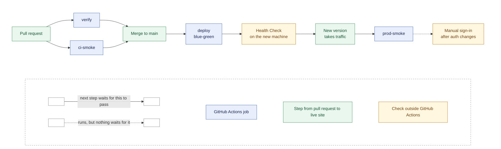

# Pipeline

For whoever wants to know what happens between a pull request and the live
site, or why a check went red: every check, where it runs and what blocks, and
how a deploy switches over, fails or is rolled back. The `pnpm` commands on
this page are the ones CI runs on its own runners; to run a check yourself,
follow its By hand column.

The following diagram shows each step from pull request to live site, with
each job's Smokes as one box:



The following table lists every check and the job it runs in. What each Smoke
checks, and how to run one by hand, is in [smoke-checks.md](smoke-checks.md).

| Check | Runs against | When | Covers |
|---|---|---|---|
| `verify` | The repository, with a dedicated test database | Every PR | Tests (including `test:smoke`), API codegen, typecheck, build, docs, CSS budget |
| [CI Smoke](#the-ci-smoke) (`ci-smoke` job) | A throwaway build of the production image, with a seeded throwaway database and the Clerk development instance | Every PR that isn't a draft | The [Public Site](smoke-checks.md#the-public-site-smoke), [Enquiry](smoke-checks.md#the-enquiry-smoke) and [Workspace](smoke-checks.md#the-workspace-smoke) Smokes. A PR from a fork skips the Workspace Smoke |
| [Health Check](#blue-green-deploys) (`/api/healthz`) | The new Fly machine | During a [Deploy](#the-deploy-job), before it takes traffic | Process up, database answers `SELECT 1` within 3s |
| [Prod Smoke](#post-deploy-validation) (`prod-smoke` job) | `https://welltutored.co.uk`, its other hostnames, and `https://clerk.welltutored.co.uk` | After a [Deploy](#the-deploy-job) | The [Public Site](smoke-checks.md#the-public-site-smoke), [Enquiry](smoke-checks.md#the-enquiry-smoke) and [Domain](smoke-checks.md#the-domain-smoke) Smokes |
| Manual sign-in | `https://welltutored.co.uk` | After merging an auth, Clerk or `@clerk/*` change | The production Clerk instance's settings and cookies |

## Deterministic CI validation

`pnpm run verify` is the deterministic quality gate: the test suites,
`pnpm run build` (which runs the [Docs Check](code-checks.md#the-docs-check)
and the typecheck) and the CSS budget, stopping at the first failure. It does
not depend on a running dev stack or a deployed URL. The steps and their order
are `verify` in the root `package.json`, and
[code-checks.md](code-checks.md) explains each.

It runs the integration tests against a dedicated `TEST_DATABASE_URL`, never
`DATABASE_URL`, and stops before them when none is supplied;
[code-checks.md](code-checks.md#api-server) has the rules.

## GitHub Actions

[.github/workflows/ci.yml](../.github/workflows/ci.yml) runs this same gate,
and the [CI Smoke](#the-ci-smoke), on every pull request, and only there.
[.github/workflows/deploy.yml](../.github/workflows/deploy.yml) runs on every
merge to `main`: the [deploy](#the-deploy-job), then the
[Prod Smoke](#post-deploy-validation).

The checks don't run again on `main`, and don't need to: the `main` ruleset
requires branches to be up to date before merging, so a pull request merges
only when it contains the latest `main`, and the tree that lands is the one
its checks tested. The cost is that after each merge, every other open pull
request has to be updated, and its checks run again, before it can merge.

What the rule doesn't require is a recent run. Checks that passed days ago
can miss drift in Chrome, the `node` base image or the Clerk development
instance, so re-run an old pull request's checks before merging it.

`deploy.yml` also has a `cache` job, beside the deploy. A pull request reads
caches only from its own branch and `main`, so this job fills them on `main`:
the installed pnpm packages, and the production image's layers, built with the
same build argument as the `ci-smoke` job. Without it they would expire after
7 days and every pull request would build cold.

The `verify` job supplies a `postgres:16` service container and points
`TEST_DATABASE_URL` at a `welltutored_test` database that it creates first.
`DATABASE_URL` is set as well, to a different database on the same server, so
the refusal to share a connection between application and integration-test data
is exercised rather than vacuously satisfied by an absent value.

Two environment constraints are load-bearing. The job runs on `ubuntu-latest`
because it is linux-x64 with glibc, and `pnpm-workspace.yaml` prunes every other
platform's native binaries from the lockfile. And pnpm is installed from the
`packageManager` field rather than a version named in the workflow, so the
workflow adds no copy of the pin. `docker/Dockerfile` and
`docker/Dockerfile.dev` each repeat it.

`docs:check` also reads the workflows' `run:` steps and validates the `pnpm`
scripts they name, so a renamed script can't reach a deploy job that calls it.

Only the `ci-smoke` job has Clerk credentials; see
[Credentials](#credentials) for why.

## The CI Smoke

The `ci-smoke` job runs the [CI Smoke](../GLOSSARY.md#delivery) alongside
`verify`, on every pull request that isn't a draft. It is a required check.
GitHub counts a skipped job as passing, so marking a draft ready for review
runs the workflow again, and the CI Smoke with it. It
checks that the production image starts and serves the site, which `verify`
can't: it builds the repository, not `docker/Dockerfile`. Without it, a broken
Dockerfile or a startup failure would first show up in `flyctl deploy` after
the merge.

It seeds a throwaway `postgres:16` database, builds `docker/Dockerfile` with the
development instance's `VITE_CLERK_PUBLISHABLE_KEY`, runs the image, and runs
the [Public Site Smoke](smoke-checks.md#the-public-site-smoke),
`pnpm smoke:public-site`, against it. Two browser checks follow, with the
runner's Google Chrome:

- The [Enquiry Smoke](smoke-checks.md#the-enquiry-smoke) (`pnpm smoke:enquiry`)
  moves through the form by tab order. It blocks.
- The [Workspace Smoke](smoke-checks.md#the-workspace-smoke) signs in as a
  `+clerk_test` user, which it promotes to owner in the job's database with the
  guarded update from [first-deploy.md](first-deploy.md#promote-the-first-owner). It blocks.
  When it fails, the run keeps its screenshot and trace as the
  `workspace-smoke-failure` artifact. A pull request from a fork skips it, with
  a notice, since it gets no secrets (see [Credentials](#credentials)).

A failure in any of the three fails the job, and so stops the merge, and the
job then prints the image's logs. The `ci-smoke` job in
`.github/workflows/ci.yml` has each step.

The image it checks isn't the one that ships. Fly builds the same Dockerfile
again with the `pk_live_` key from `fly.toml`, and giving CI that key would work
against keeping the Clerk instances separate. So this checks the image's
recipe, not the exact image. To run the Public Site Smoke against the image by
hand, see
[smoke-checks.md](smoke-checks.md#run-against-the-local-prod-image).

## Credentials

`pnpm run verify` needs no Clerk credentials. The suite passes with
`CLERK_SECRET_KEY`, `CLERK_PUBLISHABLE_KEY`, and `VITE_CLERK_PUBLISHABLE_KEY`
all absent, so the `verify` job isn't given Clerk secrets, and the interactive
`clerk auth login` flow has no place in it: that command authenticates a person
through a browser, which CI doesn't have. The gate's only external dependency
is the dedicated test database.

Two checks depend on a live Clerk instance. The Domain Smoke requests the
production instance's `/v1/environment`, which goes to Clerk directly and needs
no keys at all. The Workspace Smoke signs in through the development instance,
so the `ci-smoke` job, and no other, reads three repository secrets from the
**development** instance of the Clerk application in the dashboard, the one
whose production instance serves
`welltutored.co.uk`. That isn't necessarily the instance in a local `.env`,
which may be an accountless application
([local-docker.md](local-docker.md#which-clerk-instance-is-which)). The test
user is created in that instance's dashboard, under Users.

| Secret | Used for |
| --- | --- |
| `CLERK_TEST_PUBLISHABLE_KEY` | The image's `VITE_CLERK_PUBLISHABLE_KEY` build argument, and its `CLERK_PUBLISHABLE_KEY` |
| `CLERK_TEST_SECRET_KEY` | The image's `CLERK_SECRET_KEY` |
| `CLERK_TEST_EMAIL` | The `+clerk_test` user the Workspace Smoke signs in as. A secret only because the repository is public. |

The job refuses keys that aren't `pk_test_` and `sk_test_`. Dependabot pull
requests don't get repository secrets, so the same three are also set as
**Dependabot secrets**, and those runs read them. A pull request from a fork
gets neither: the image builds with an empty publishable key and runs with the
`.env.example` placeholder secret key, the Public Site Smoke and the Enquiry
Smoke still pass, and the Workspace Smoke is skipped with a notice. It runs
when the change is on a branch of this repository. A rotated key has to be
updated in both places.

What the Workspace Smoke can't cover is the production Clerk instance itself:
its first-party cookies on `clerk.welltutored.co.uk` and the dashboard
settings that can differ between the two instances. That is a manual sign-in
after merging an auth or Clerk change
([CONTRIBUTING.md](../CONTRIBUTING.md#prepare-a-pull-request)).

## The deploy job

The `deploy` job in `.github/workflows/deploy.yml` runs on every merge to
`main`. A failure in `verify` or `ci-smoke` stops a deploy by stopping the
merge, since both are required checks. It checks out, installs
`flyctl` and runs `flyctl deploy`. The checks against the live site come after
it, in the [`prod-smoke` job](#post-deploy-validation).

The deploy is [blue-green](#blue-green-deploys), switching only after the new
machine passes the Health Check.
[ADR-0003](adr/0003-no-staging-environment.md) is why there is no staging
environment in front of this.

It has its own `concurrency` group, without `cancel-in-progress`.
`ci.yml` cancels superseded pull-request runs, which is right for
verification and wrong for a deploy: a cancelled one leaves the
[Deployment](../GLOSSARY.md#delivery) wherever `flyctl` had got to. Deploys
queue instead.

It does **not** apply the schema. That is
[ADR-0002](adr/0002-schema-by-deliberate-push.md), and it is the point.

## Post-deploy validation

The `prod-smoke` job runs the [Prod Smoke](../GLOSSARY.md#delivery) after the
`deploy` job passes, against the live site. A failure in any of its checks
fails the run. In order:

- the [Public Site Smoke](smoke-checks.md#the-public-site-smoke), without
  waivers;
- the [Enquiry Smoke](smoke-checks.md#the-enquiry-smoke), in the runner's
  Google Chrome. It intercepts the final request, so it never creates a real
  Enquiry on the Deployment;
- the [Domain Smoke](smoke-checks.md#the-domain-smoke), with
  `SMOKE_REDIRECT_FROM` set to the Deployment's other hostnames.

A successful Deploy doesn't mean a usable Deployment, which is why it runs at
all. It is a job of its own, so a failure can be re-run without redeploying,
and it stays out of the `deploy` job's `concurrency` group, since it changes
nothing on the Deployment. It isn't a required check, since
it runs only after a merge.

**A red `prod-smoke` on a merge to `main` is a real failure**, and visitors
are already seeing it. It isn't something to wave through:
[roll back](#roll-back-a-deploy), or fix it on `main`.

## Blue-green deploys

`fly.toml` sets `strategy = "bluegreen"`. A deploy boots a new machine beside
the current one, waits for it to pass the Health Check, moves traffic to it, and
then destroys the old one. So a version that doesn't start, or can't reach the
database, never takes traffic. The machine also gets a new ID on every deploy,
so nothing may depend on one.

`fly.toml` points Fly's health check at `/api/healthz`, the Health Check. It
answers `200` only when the database answers a `SELECT 1` within 3 seconds, and
`503` otherwise, so a wrong `DATABASE_URL` or an unreachable Neon takes the
machine out of rotation. It checks nothing more because Fly runs it every 15
seconds. Fly then serves its own proxy error rather than the
app's. That is accepted, since every page needs the database anyway. The 3
seconds sit above Neon's wake-from-suspend time and below the check's 5-second
`timeout`.

What blue-green does **not** catch: broken pages, a missing Tutor, or code that
doesn't match the live schema, which still answers `SELECT 1`. Those surface in
the [Prod Smoke](../GLOSSARY.md#delivery), which runs after the switch,
against the version visitors already see.

## Recover from a failed deploy

A failed deploy is a red `Deploy to Fly` step. `flyctl` reports the new
machine failing its checks, and the old machine keeps serving the previous
version. To clean up after it:

1. List the machines:

   ```
   fly machines list
   ```

2. If a machine from the failed attempt is still there, destroy it:

   ```
   fly machines destroy MACHINE_ID --force
   ```

   Replace `MACHINE_ID` with that machine's ID.

## Roll back a deploy

A deploy that passes but breaks the site is a red `prod-smoke` after a green
`deploy`. The new version is live, and nothing rolls it back by itself.
To go back to the previous image, work from a checkout of `main`, since
`fly deploy` still reads `fly.toml` from there:

1. List the releases with their images:

   ```
   fly releases --image
   ```

2. Deploy the image of the release before the current one:

   ```
   fly deploy --image PREVIOUS_IMAGE
   ```

   Replace `PREVIOUS_IMAGE` with that release's image reference from the
   first command's output.

3. Revert the change on `main`, or the next merge ships it again.

**Rolling back past a schema push is only safe if the push was additive.** The
schema is pushed before merge
([schema-changes.md](schema-changes.md#push-or-merge-first)), so the previous
image runs against the new schema. A new nullable column or table is fine. A
renamed or dropped column breaks the old code too, and the rollback then means pushing the old schema back by hand
([schema-changes.md](schema-changes.md)).
